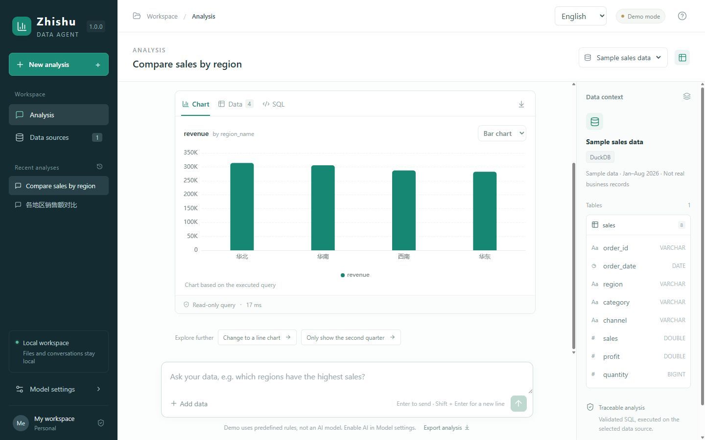

# InsightBridge 知数

A bilingual, locally running data analysis assistant. Ask in natural language and get inspectable SQL, charts and findings.

[简体中文](README.md) · [Download for Windows](https://github.com/Runc3m/zhishu-data-agent/releases) · [User guide](docs/usage.en.md) · [Roadmap](docs/roadmap.en.md)



## From questions to results

- **Natural-language analysis**: inspect the schema, plan a query, execute read-only SQL and attempt bounded repairs when needed.
- **Charts beside their queries**: bar, line and pie charts, sortable result tables and the SQL that actually ran.
- **Local data workspace**: import CSV or connect to PostgreSQL / MySQL; sources and analysis history are saved automatically.
- **Chinese and English**: switch the interface, analysis messages and suggested questions without rewriting existing conversations or raw data.
- **Simple model setup**: DeepSeek requires only an API key; other Chat Completions-compatible providers and local models are supported too.
- **Business definitions**: describe columns, metrics and relationships per source; analyses retain the context version used to explain their basis.
- **Try it without a key**: demo mode executes predefined queries against synthetic records, without calling a model.
- **Export your work**: download query results as CSV and analysis records as Markdown.

For individual analysts, operators and developers exploring data, checking metrics and preparing analysis. This is a single-user local tool, without public hosting or team accounts.

## Quick start

### Windows users

1. Download the latest `Zhishu-v1.1.0-windows-x64.zip` from [Releases](https://github.com/Runc3m/zhishu-data-agent/releases).
2. Extract the entire archive, open the `Zhishu` folder and double-click `Zhishu.exe`.
3. Your browser opens the workspace. Select a suggested question to explore the sample sales data.

No Python or Node.js installation is required. Keep the launch center open or minimized while working, then select Quit Zhishu. See the [user guide](docs/usage.en.md) for installation, updates and storage locations.

### Developers

Requires Windows, Python 3.13, Node.js 22+ and pnpm 11.19.0.

```powershell
git clone https://github.com/Runc3m/zhishu-data-agent.git
cd zhishu-data-agent
.\start.ps1 -Rebuild
```

Open the local address printed by the script. See the [development guide](docs/development.en.md) for testing, architecture and packaging.

## Try an analysis

Select Sample sales data, ask “Monthly sales trend”, follow up with “Only show the second quarter”, then “What about profit?”. Change the chart type, inspect the SQL or export results.

For your own CSV, preview columns first. Open-ended questions require AI in Model settings. Follow the [model setup guide](docs/models.en.md).

Files and history are stored locally. With remote AI enabled, questions, schema, configured business context, recent conversation and up to 30 result rows are sent to the selected provider and consume its API allowance.

See [business context](docs/business-context.en.md) and the [evaluation guide](docs/evaluation.en.md) for defining metrics and checking results.

## Documentation and contributions

[User guide](docs/usage.en.md) · [Model setup](docs/models.en.md) · [Development](docs/development.en.md) · [FAQ](docs/faq.en.md) · [Contributing](CONTRIBUTING.en.md) · [Roadmap](docs/roadmap.en.md) · [Changelog](CHANGELOG.en.md)

Reproducible bug reports, suggestions and pull requests are welcome. Original code is under the [MIT license](LICENSE). See [third-party notices](THIRD_PARTY_NOTICES.md) for dependency licenses and product inspiration.


## Local development edition: InsightBridge / 知数

The English product name is **InsightBridge**; the Chinese name remains 知数. Existing repository URLs, storage paths, health-check IDs and historical release filenames remain compatible. These changes have not yet been published as a new Windows package.

- **Bilingual retrieval**: FastEmbed / ONNX Runtime runs pretrained multilingual-e5-small locally; RRF combines semantic and BM25 rankings. Retrieve fields, metrics, schemas and ETL, preserving mandatory metric exclusions and relationship constraints. Missing embeddings visibly fall back to keywords. No request-time downloads; complete business snapshots are retained for audit rather than injected wholesale.
- **Real warehouse**: upload up to 20 CSVs in a ZIP (256 MB compressed / 512 MB expanded). Olist's nine-file format creates DuckDB raw, staging, order fact, daily report and load-history tables. Historical dates stay in 2016–2018 and currency stays BRL. No invented costs or refunds.
- **Pipeline investigations**: reuse SQLGlot table lineage and actual ETL, load records, knowledge retrieval and read-only SQL. At most 8 tool actions and 2 repairs. Independent coverage, amount, reconciliation and refresh checks cover the local snapshot, not arbitrary ETL languages or source-system completeness.

Setup: install `requirements-rag.txt`, then run `python -m scripts.setup_warehouse --download --embeddings`. Use `--archive FILE` for an existing official Olist ZIP. Start the existing `start.ps1`; the UI prioritizes the real warehouse when available. On the data page inspect the pipeline and create isolated healthy/fault copies. Fault labels are withheld from the planner; originals remain unchanged. Olist data is CC BY-NC-SA 4.0; see [publisher](https://www.kaggle.com/datasets/olistbr/brazilian-ecommerce).

Run `python -m evals.warehouse --live --app-storage storage` for real model evaluation (provider fees apply), and `python -m evals.retrieval` for the synthetic bilingual retrieval probe. Reports are written under `evaluation-results/`. Automatic evidence checks do not establish narrative correctness; manually review the explanations.
- **Investigation**: choose Automatic, Single query or Investigation beside the input. AI investigations allow five successful analytical queries and two repairs in total, and stop repeated queries. Up to three additional read-only source diagnostics run first. A soft 180-second budget is checked before starting another step; in-flight calls may exceed it.
- **Inspectable evidence**: each step exposes executed SQL, rows and truncation. Retrieved passages, observations, reconciliation and stopping reasons persist in history and Markdown exports.
- **Summary scope**: numeric profiles cover all returned rows, with a sample of at most 30 rows. A capped result is not the full database; population claims require aggregate SQL. Mechanical column sums do not imply additive business metrics.

The initial source is Commerce investigation demo. Its first card compares August with July 2026 through five executed queries: order coverage and quality, refund quality and relationships, overall totals, category contributions, and a follow-up on the largest contributor. Synthetic net sales are CNY 5,890 → 4,960, a change of -930. Electronics contributes -1,240, Home +310, and Sports 0; the breakdown reconciles.

Two further cards demonstrate ambiguous refund-rate definitions and missing September data. This rule demo supports its card questions only. Edited demo definitions require AI mode; the original Sales demo remains available separately.

For your own CSV or database, enable AI. Automatic diagnostics inspect only selected typed columns, not every quality condition. Date bounds alone do not prove ingestion completeness. Verify model-generated reconciliation and causal claims against evidence. Mocked-planner tests do not measure real-model accuracy; live evaluation needs a configured provider.
