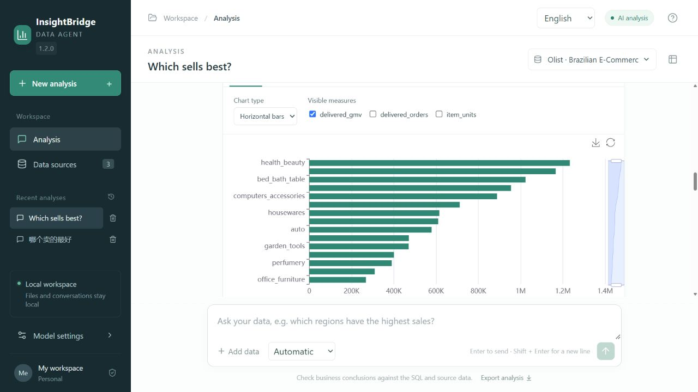

<div align="center">

# InsightBridge · 知数

### Ask a business question. Get an analysis you can check.

An open-source, bilingual AI data workspace. Connect data, clarify metrics, explore charts, and ask what comes next.

[简体中文](README.md) · **English**

[](https://github.com/Runc3m/zhishu-data-agent/releases/latest)
[](https://github.com/Runc3m/zhishu-data-agent/actions/workflows/checks.yml)
[](LICENSE)

[**Download for Windows**](https://github.com/Runc3m/zhishu-data-agent/releases/latest) · [Quickstart](#quickstart) · [Documentation](docs/usage.en.md) · [Report an issue](https://github.com/Runc3m/zhishu-data-agent/issues)

</div>



*Actual application screenshot using public Olist historical data. Import the dataset separately; free-form AI questions require a configured model.*

## Start with the question you already have

“Which sells best?” could mean sales value, units, or profit. InsightBridge uses your data and business definitions to explain the comparison, execute queries, and interpret the results. Keep asking questions, or inspect the SQL behind the answer.

| Your task | Ask | What InsightBridge helps with |
| --- | --- | --- |
| Understand sales performance | Which category sells best? Do value and volume tell the same story? | Compare metrics, rankings, and trends with an explicit period and definition |
| Make sense of a result | Explain this simply. What should I look into next? | Explain existing query evidence and suggest actions to validate and missing information |
| Clarify a business metric | Does delivered GMV include shipping? How is it calculated? | Retrieve configured business definitions alongside schema and metric context |
| Investigate a reporting issue | Check the daily sales report and trace issues through the pipeline | Inspect ETL, table lineage, and load records in the registered Olist pipeline and run checks |

Built for individual analysts, operators, and developers exploring data, checking metrics, and drafting analyses. Currently a local, single-user workspace.

## One analysis. Keep the conversation going.

Using Olist historical e-commerce data:

1. **“Which sells best?”** By delivered goods value, `health_beauty` leads at **BRL 1,233,131.72**. By units sold, `bed_bath_table` leads at **10,953 units**.
2. **“Explain this simply.”** The category with the highest goods value can differ from the one selling the most items. Goods value excludes shipping and is not profit.
3. **“Which category should I prioritize?”** Get candidate directions based on the queries, along with the cost, inventory, and other evidence needed before deciding.

The figures can be checked against public data and reference SQL. The third step supports a decision; a sales ranking alone cannot establish business returns. [See the recorded questions and results](docs/evaluations/conversational-bi.json)

## Why InsightBridge

- **From a question to an analysis report.** Broad questions, multiple queries, and explanatory follow-ups produce conclusions, findings, actions to validate, and limitations.
- **Charts that fit the data.** Choose from 12 chart and metric views where compatible with the returned fields. Explore multiple series, switch metrics, zoom, and export images or each panel's CSV.
- **Your business definitions as context.** Configure field meanings, metrics, and relationships per data source. Retrieve relevant passages and retain context versions with the analysis.
- **Evidence you can inspect.** Expand executed read-only SQL, results, retrieved passages, and investigation steps. Export analyses to Markdown.
- **A local workspace in two languages.** Save sources and conversations, delete individual chats, and choose your model provider. Simplified Chinese is the default; switch to English at the top right.

**Views:** KPI cards · column · horizontal bar · line · area · stacked bar · pie · donut · scatter · heatmap · treemap · histogram.

## Quickstart

### Windows: download, extract, open

1. [Download the latest Windows x64 ZIP](https://github.com/Runc3m/zhishu-data-agent/releases/latest), extract the entire archive, and open `Zhishu.exe`. No Python or Node.js installation required.
2. The local workspace opens in your browser. Choose Sales demo or Commerce investigation demo and click a suggested question. **No API key needed for the rule-based demos.**
3. For free-form questions, open Model settings and add your own DeepSeek key or a Chat Completions-compatible service. Compatible local models are also supported.

Demo mode uses preset questions and synthetic data without calling an LLM. AI mode uses your configured service and may incur API charges. [Installation and upgrades](docs/usage.en.md) · [Model setup](docs/models.en.md)

### Bring your data

| Source | How it works |
| --- | --- |
| CSV | Upload one file, preview its fields, and start analyzing |
| Multi-CSV ZIP | Import a package and query its tables within one DuckDB source |
| PostgreSQL / MySQL | Connect with a read-only database account |
| Public Olist e-commerce data | Upload the official nine-file ZIP to build 13 raw, staging, fact, report, and load-log tables |

Olist contains **99,441 orders** from 2016–2018, with amounts in BRL. Download it separately under its CC BY-NC-SA 4.0 license; it is not bundled with the application. [Official dataset](https://www.kaggle.com/datasets/olistbr/brazilian-ecommerce) · [Import and investigation guide](docs/warehouse.en.md)

### Developers: run from source

Windows, Python 3.13, Node.js 22+, and pnpm 11.19.0:

```powershell
git clone https://github.com/Runc3m/zhishu-data-agent.git
cd zhishu-data-agent
.\start.ps1 -Rebuild
```

Optional local multilingual semantic retrieval for the source edition:

```powershell
.\.venv\Scripts\python -m pip install -r requirements-rag.txt
.\.venv\Scripts\python -m scripts.setup_warehouse --download --embeddings
```

The second command downloads Olist and a pretrained retrieval model; no training is needed. The Windows package uses keyword retrieval and does not bundle the semantic model. With the optional source setup, retrieval combines BM25 and multilingual embeddings. The interface reports the actual mode. [Development guide](docs/development.en.md)

## Evidence and boundaries

InsightBridge reads the schema and business context, retrieves relevant definitions, plans and validates read-only queries, and retains the evidence. Failed queries have a bounded repair budget.

- **Public evaluations.** Bilingual business cases, Olist investigations, and conversational checks are available. Six conversational cases passed their specified checks: a small smoke test, not an accuracy claim for every business question. [Methods and records](docs/evaluation.en.md)
- **Local storage.** With remote AI enabled, questions, schema, business passages, recent conversation, and bounded query results/statistical summaries are sent to the selected provider. Running locally does not mean zero data transmission to remote AI. [Models and data](docs/models.en.md)
- **Defined scope.** No team accounts, row-level permissions, scheduled refresh, or public hosting. No direct Excel import or queries across separate data sources. Lineage investigations cover registered pipelines; model conclusions and recommendations need review.

## Help solve real questions

Share a sanitized schema, question, expected result, and observed behavior in an issue. Do not upload API keys or private business records. Contributions of test cases, translations, and connectors are welcome. If InsightBridge helps you, star the repository to follow its progress.

[User guide](docs/usage.en.md) · [Business context](docs/business-context.en.md) · [FAQ](docs/faq.en.md) · [Roadmap](docs/roadmap.en.md) · [Changelog](CHANGELOG.en.md) · [Contributing](CONTRIBUTING.md)

## Built on established tools

React and Apache ECharts power the interface; FastAPI orchestrates analysis; DuckDB executes local queries; SQLGlot parses and validates SQL; optional FastEmbed / ONNX Runtime provides local multilingual retrieval.

Product design draws on [WrenAI](https://github.com/Canner/WrenAI), [Data Formulator](https://github.com/microsoft/data-formulator), and [DataHub Analytics Agent](https://github.com/datahub-project/analytics-agent). InsightBridge is an independent project, not an official product of those projects.

Original code is [MIT licensed](LICENSE). Dependencies, optional models, and example data retain their own licenses. [Third-party notices](THIRD_PARTY_NOTICES.md)
