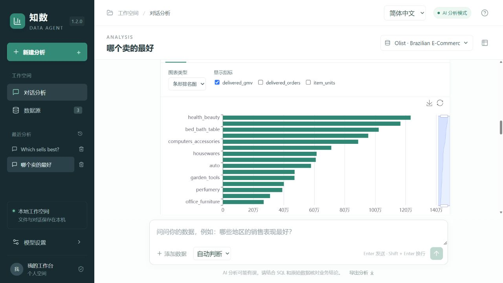

<div align="center">

# 知数 · InsightBridge

### 用业务语言提问，得到有依据的分析。

一个开源的中英文 AI 数据分析工作台。连接数据、理解指标、探索图表，再追问下一步。

**简体中文** · [English](README.en.md)

[](https://github.com/Runc3m/zhishu-data-agent/releases/latest)
[](https://github.com/Runc3m/zhishu-data-agent/actions/workflows/checks.yml)
[](LICENSE)

[**下载 Windows 应用**](https://github.com/Runc3m/zhishu-data-agent/releases/latest) · [快速开始](#快速开始) · [使用文档](docs/usage.zh-CN.md) · [反馈问题](https://github.com/Runc3m/zhishu-data-agent/issues)

</div>



*真实运行截图，使用 Olist 公开历史数据。数据需单独导入；AI 自由问答需配置模型。*

## 从一个业务问题开始

“哪个卖得最好”可能指销售额、销量，也可能指利润。知数会结合数据与业务说明，给出比较口径、查询结果和解释；你可以继续追问，也可以检查背后的 SQL。

| 你想解决的问题 | 可以这样问 | 知数帮你做什么 |
| --- | --- | --- |
| 看清销售表现 | 哪个品类卖得最好？销售额和销量的排名一样吗？ | 对比指标、排名与趋势，说明时间范围和统计口径 |
| 读懂分析结果 | 看不懂，解释一下。下一步该关注什么？ | 用已有查询证据解释结果，提出待验证的建议与缺失信息 |
| 统一指标定义 | 已交付商品成交额包含运费吗？怎么算的？ | 检索已配置的业务说明，结合字段与指标定义回答 |
| 排查报表异常 | 调查日报表是否有数据问题，沿处理链路验证原因 | 在已注册的 Olist 管道中查看 ETL、表级血缘和加载记录，执行核验 |

适合个人分析师、运营人员和开发者做数据探索、指标核对与分析初稿。当前是本地单用户工作台。

## 一次分析，可以继续往下问

以 Olist 历史电商数据为例：

1. **“哪个卖得最好？”** 按已交付商品成交额比较，`health_beauty` 为 **1,233,131.72 BRL**；按售出件数比较，`bed_bath_table` 为 **10,953 件**。
2. **“看不懂，解释一下。”** 金额最高与件数最多可以是不同品类；商品成交额不包含运费，也不等于利润。
3. **“我该优先经营什么品类？”** 基于已查结果给出候选方向，并指出还需要成本、库存等信息才能进一步判断。

前两项数值可由公开数据与参考 SQL 核对。第三项属于辅助分析，不能从销售排名直接推出经营收益。[查看实测问题与结果](docs/evaluations/conversational-bi.json)

## 为什么用知数

- **从问题到分析报告。** 支持宽泛提问、多查询分析和解释追问，结果包含结论、关键发现、待验证建议与口径局限。
- **图表随数据选择。** 12 种图形与指标视图，按返回字段提供兼容选项；支持多系列趋势、指标切换、缩放、图片和逐面板 CSV 导出。
- **让 AI 参考你的业务定义。** 每个数据源可配置字段、指标和关联说明。检索业务片段，记录上下文版本，方便回看答案依据。可从真实数据生成字段取值草稿，确认后保存。
- **越用越准。** 把结果正确的回答标记为“已验证查询”，之后的相似问题会参考这些问题与 SQL。
- **每一步可以检查。** 展开实际执行的只读 SQL、结果、检索片段和调查步骤；分析记录可导出 Markdown。
- **本地工作空间，中英双语。** 保存数据源和聊天记录，支持删除单个会话。默认简体中文，右上角切换 English；自选模型服务。

**图表视图：** 指标卡 · 柱状图 · 条形图 · 折线图 · 面积图 · 堆叠柱状图 · 饼图 · 环形图 · 散点图 · 热力图 · 矩形树图 · 直方图。

## 快速开始

### Windows：下载，解压，打开

1. [下载最新 Windows x64 ZIP](https://github.com/Runc3m/zhishu-data-agent/releases/latest)，完整解压后双击 `Zhishu.exe`，无需安装 Python 或 Node.js。
2. 浏览器打开本地工作台。选择“销售演示数据”或“电商调查演示”，点击建议问题，**无需 API Key 即可体验规则演示**。
3. 想自由提问：打开“模型设置”，配置自己的 DeepSeek Key，或兼容 Chat Completions 的模型服务；也可连接兼容的本地模型。

规则演示使用预设问题和合成数据，不调用大模型。AI 模式使用你配置的服务，可能产生 API 费用。[安装与升级](docs/usage.zh-CN.md) · [模型配置](docs/models.zh-CN.md)

### 带上自己的数据

| 数据来源 | 使用方式 |
| --- | --- |
| CSV | 上传一个文件，预览字段后开始分析 |
| 多 CSV ZIP | 上传数据包，在同一 DuckDB 数据源内查询多张表 |
| PostgreSQL / MySQL | 用只读账号连接数据库 |
| Olist 公开电商数据 | 上传官方九文件 ZIP，生成 13 张原始、清洗、事实、报表与加载记录表 |

Olist 包含 **99,441 笔订单**，覆盖 2016–2018 年，金额单位 BRL。数据单独下载，遵循其 CC BY-NC-SA 4.0 许可；不随应用分发。[官方数据](https://www.kaggle.com/datasets/olistbr/brazilian-ecommerce) · [导入与调查指南](docs/warehouse.zh-CN.md)

### 开发者：从源码运行

Windows、Python 3.13、Node.js 22+、pnpm 11.19.0：

```powershell
git clone https://github.com/Runc3m/zhishu-data-agent.git
cd zhishu-data-agent
.\start.ps1 -Rebuild
```

源码版可选安装本地多语言语义检索：

```powershell
.\.venv\Scripts\python -m pip install -r requirements-rag.txt
.\.venv\Scripts\python -m scripts.setup_warehouse --download --embeddings
```

第二条命令下载 Olist 和预训练检索模型，无需训练。Windows 发布包使用关键词检索，不包含语义模型；源码版安装完成后可使用 BM25 + 多语言向量混合检索。界面会显示实际检索模式。[开发指南](docs/development.zh-CN.md)

## 答案依据与使用边界

知数先读取数据结构与业务上下文，检索相关定义，再规划并校验只读查询。分析结果保留证据，失败时只做有限修正。

- **评测公开。** 提供中英文业务标准题、Olist 调查与对话测试记录。对话测试的 6 个案例通过各自检查项，属于小规模冒烟测试，不代表所有业务问题的准确率。[评测方法与记录](docs/evaluation.zh-CN.md)
- **数据存储在本机。** 启用远程 AI 时，问题、结构、业务片段、与问题相似的最多 3 条已验证查询、近期对话及有限查询结果/统计摘要会发送至所选模型服务；本地运行不意味着远程 AI 零数据传输。[模型与数据说明](docs/models.zh-CN.md)
- **范围明确。** 暂不提供团队账号、行级权限、定时刷新或公网托管；不支持 Excel 直接导入和跨数据源查询。血缘排查限已注册管道，建议与模型结论需要核对。

## 参与，一起把真实问题解决好

遇到问题时，欢迎提交脱敏的字段结构、提问、预期结果和实际表现。不要上传 API Key 或业务原始数据。你也可以贡献案例、翻译与连接器；如果知数对你有用，欢迎 Star，方便持续关注更新。

[使用指南](docs/usage.zh-CN.md) · [业务上下文](docs/business-context.zh-CN.md) · [常见问题](docs/faq.zh-CN.md) · [路线图](docs/roadmap.zh-CN.md) · [更新日志](CHANGELOG.md) · [贡献指南](CONTRIBUTING.md)

## 构建在成熟工具之上

React + Apache ECharts 提供交互界面；FastAPI 编排分析；DuckDB 执行本地查询；SQLGlot 解析与校验 SQL；可选 FastEmbed / ONNX Runtime 提供本地多语言检索。

产品设计参考 [WrenAI](https://github.com/Canner/WrenAI)、[Data Formulator](https://github.com/microsoft/data-formulator) 与 [DataHub Analytics Agent](https://github.com/datahub-project/analytics-agent)。知数是独立项目，不是上述项目的官方产品。

自有代码采用 [MIT](LICENSE)；依赖、可选模型和示例数据分别遵循各自许可。[第三方说明](THIRD_PARTY_NOTICES.md)
