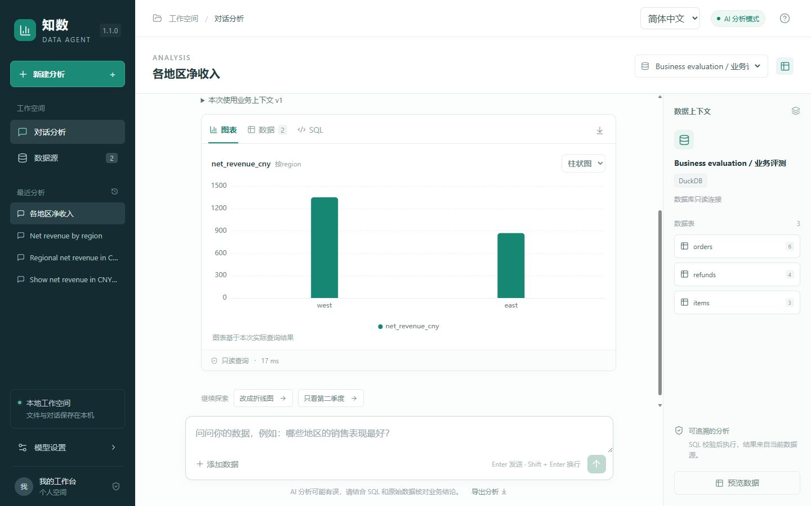

# 知数 InsightBridge

一个支持中英文、在本地运行的数据分析助手。用自然语言提问，获得可检查的 SQL、图表与分析结论。

[English](README.en.md) · [下载 Windows 应用](https://github.com/Runc3m/zhishu-data-agent/releases) · [使用指南](docs/usage.zh-CN.md) · [路线图](docs/roadmap.zh-CN.md)



## 从问题到结果

- **自然语言问数**：读取数据结构、制定查询计划、执行只读 SQL，在失败时进行有限修正。
- **图表与查询放在一起**：柱状图、折线图、饼图、可排序数据表，以及实际执行的 SQL。
- **本地数据工作空间**：导入 CSV，或连接 PostgreSQL / MySQL；数据源与分析历史自动保存。
- **中英文切换**：界面、分析提示与建议问题随语言切换；已有对话和原始数据保持原样。
- **轻量模型配置**：DeepSeek 只需填写 API Key；也支持兼容 Chat Completions 的服务及本地模型。
- **理解业务定义**：为数据源配置字段、指标与关联说明；分析保留所用上下文版本，方便回看依据。
- **无需密钥即可体验**：规则演示用预设查询分析实际执行的模拟记录，不调用模型。
- **带走结果**：导出 CSV 查询结果和 Markdown 分析记录。

适合个人分析师、运营人员与开发者探索数据、核对指标、准备分析材料。当前是单用户本地工具，不包含公网托管与团队账号。

## 快速开始

### Windows 用户

1. 从 [Releases](https://github.com/Runc3m/zhishu-data-agent/releases) 下载最新的 `Zhishu-v1.1.0-windows-x64.zip`。
2. 完整解压，打开 `Zhishu` 文件夹，双击 `Zhishu.exe`。
3. 浏览器会打开分析工作空间。点击建议问题，即可体验内置销售数据。

不需要安装 Python 或 Node.js。使用时保留启动中心，可最小化；结束时点击“退出知数”。安装、升级与存储位置见[使用指南](docs/usage.zh-CN.md)。

### 开发者

需要 Windows、Python 3.13、Node.js 22+ 和 pnpm 11.19.0。

```powershell
git clone https://github.com/Runc3m/zhishu-data-agent.git
cd zhishu-data-agent
.\start.ps1 -Rebuild
```

打开脚本显示的本地地址。测试、架构与打包见[开发指南](docs/development.zh-CN.md)。

## 一个使用示例

选择“销售演示数据”，提问“每月销售趋势”，接着问“只看第二季度”，再试试“那利润呢”。可以切换图表类型、查看 SQL、导出结果。

分析自己的 CSV 时，先预览字段；自由提问需要在“模型设置”启用 AI。详细步骤见[模型配置](docs/models.zh-CN.md)。

文件和历史记录存储在本机。启用远程 AI 后，问题、数据结构、已配置的业务上下文、最近对话与最多 30 行查询结果会发送给所选模型服务，并使用该服务的 API 额度。

业务口径如何配置、如何核验结果，见[业务上下文](docs/business-context.zh-CN.md)与[评测说明](docs/evaluation.zh-CN.md)。

## 文档与参与

[使用指南](docs/usage.zh-CN.md) · [模型配置](docs/models.zh-CN.md) · [开发构建](docs/development.zh-CN.md) · [常见问题](docs/faq.zh-CN.md) · [贡献指南](CONTRIBUTING.md) · [路线图](docs/roadmap.zh-CN.md) · [更新日志](CHANGELOG.md)

欢迎提交可复现的问题、改进建议与 Pull Request。自有代码使用 [MIT 许可证](LICENSE)；依赖许可与产品思路致谢见[第三方说明](THIRD_PARTY_NOTICES.md)。


## 本地开发版：知数 InsightBridge

英文产品名为 **InsightBridge**，中文继续使用“知数”。现有 GitHub 地址、存储目录、健康检查标识和历史发行包文件名保持兼容；本轮功能尚未发布为新的 Windows 安装包。

- **双语业务检索**：复用 FastEmbed / ONNX Runtime 运行本地 multilingual-e5-small，与 BM25 通过 RRF 合并排序。知识覆盖字段、指标、表结构和 ETL，最多返回 8 个检索片段；另保留口径、排除条件和关联约束。未安装模型时界面明确显示关键词降级，不在提问时自动下载。完整业务快照供历史审计使用，不再整份注入提示词。
- **真实数据仓库**：支持多 CSV 的 ZIP 数据包（压缩后 256 MB、解压后 512 MB、最多 20 个文件）。识别 Olist 九文件格式，使用 DuckDB 建立原始层、清洗订单、订单事实、每日报表与加载记录。日期保持 2016–2018、币种 BRL，无成本和退款时拒绝利润或净收入问题。
- **SQL 链路调查**：对已注册的 Olist 管道提供 SQLGlot 解析的表级血缘、实际 ETL、加载记录、知识检索与只读 SQL 工具，最多 8 次工具行动和 2 次修复。独立检查关联金额、漏数、报表对账与刷新版本；不等于任意 ETL 语言解析或源系统完整性保证。
- **多步调查**：输入框可选择自动判断、单次查询或多步调查。AI 调查最多执行 5 条成功分析查询、共 2 次修复；重复查询会停止。另有最多 3 张表的只读质量观察。180 秒软预算在下一步开始前检查，正在执行的调用可能使总耗时超过预算。
- **可检查的依据**：展开每一步查看实际 SQL、结果和截断状态；业务片段、质量观察、核对结果与停止原因保存进历史，并包含在 Markdown 导出中。
- **更准确的总结范围**：提供所有已返回行的数值概况及前 30 行样本；返回片段不是整个数据库，求总体指标仍需聚合 SQL。数字列机械求和不代表指标具有可加性。

导入 Olist 后首次打开优先选择真实数据；未导入时保留“电商调查演示”。演示卡可运行 2026 年 8 月对比 7 月的五步合成调查，净销售额为 5,890 → 4,960 元，总变化 -930 元。该演示仍是教学数据，不能当作真实模型成绩。

真实数据和本地检索模型安装（首次需要联网；使用预训练模型，无需训练）：

```powershell
.\.venv\Scripts\python -m pip install -r requirements-rag.txt
.\.venv\Scripts\python -m scripts.setup_warehouse --download --embeddings
.\start.ps1
```

也可以在“添加数据源 → ZIP 数据包”上传已下载的 Olist ZIP，或使用 `--archive 文件路径` 代替 `--download`。在数据源页面展开“数据处理链路”，选择正常对照或四类故障以创建独立实验副本。故障标签不会进入模型上下文，原始数据库不会被修改。数据、模型和本地密钥不提交到 Git。Olist 是 CC BY-NC-SA 4.0 的匿名历史数据，见[官方来源](https://www.kaggle.com/datasets/olistbr/brazilian-ecommerce)。

真实模型评测：`python -m evals.warehouse --live --app-storage storage`；离线检索评测：`python -m evals.retrieval`。前者会消耗已配置服务商的额度，并发送选中公开数据的查询结果；结果保存在 `evaluation-results/`。故障结论需人工复核，自动证据门槛不等于因果解释正确率。

另外两张卡演示“退款率”口径澄清和 9 月尚未导入的边界。该规则演示仅支持卡片问题；若修改演示业务定义，需要启用 AI 才会按新定义查询。普通“销售演示数据”保留原有功能。

AI 调查适用于自己的 CSV 或数据库，但自动检查只覆盖部分类型字段，不是完整数据质量审计；日期起止不能证明导入完整。模型生成的核对与原因解释仍需检查证据。真实模型效果需另行使用配置的模型评测，本地模拟模型测试不能代表真实模型准确率。
